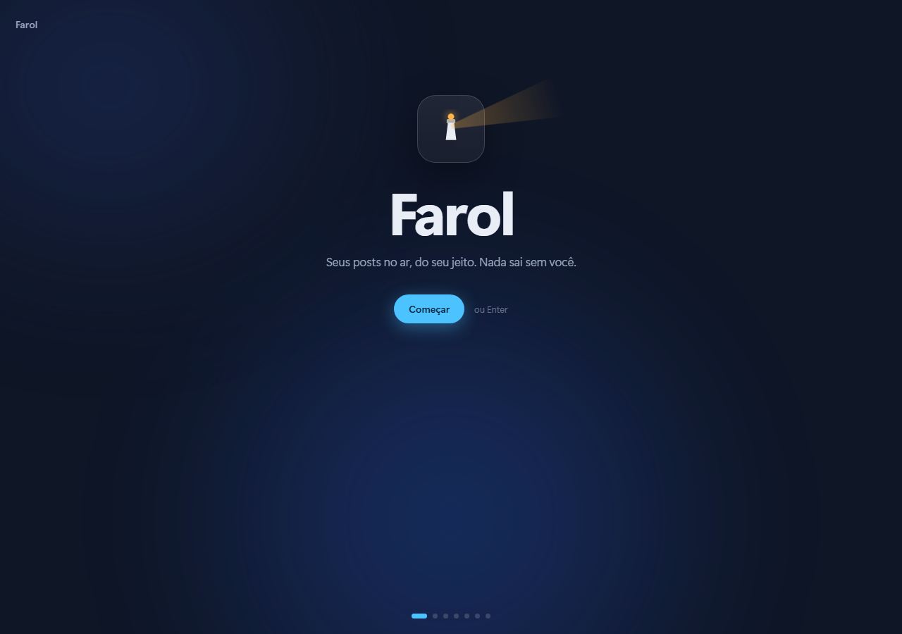
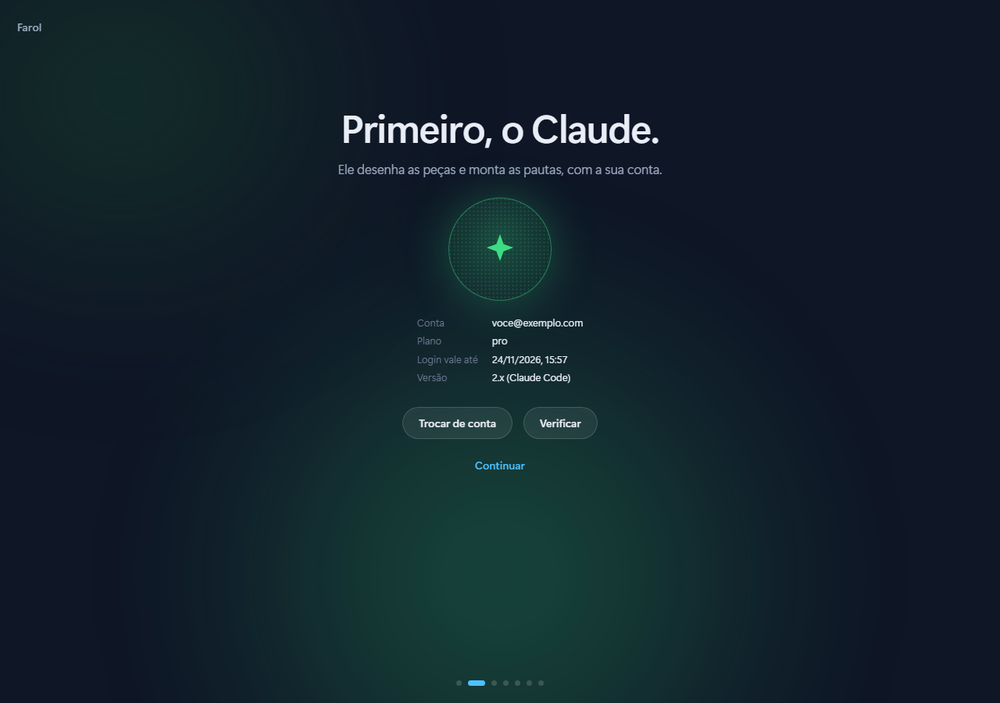
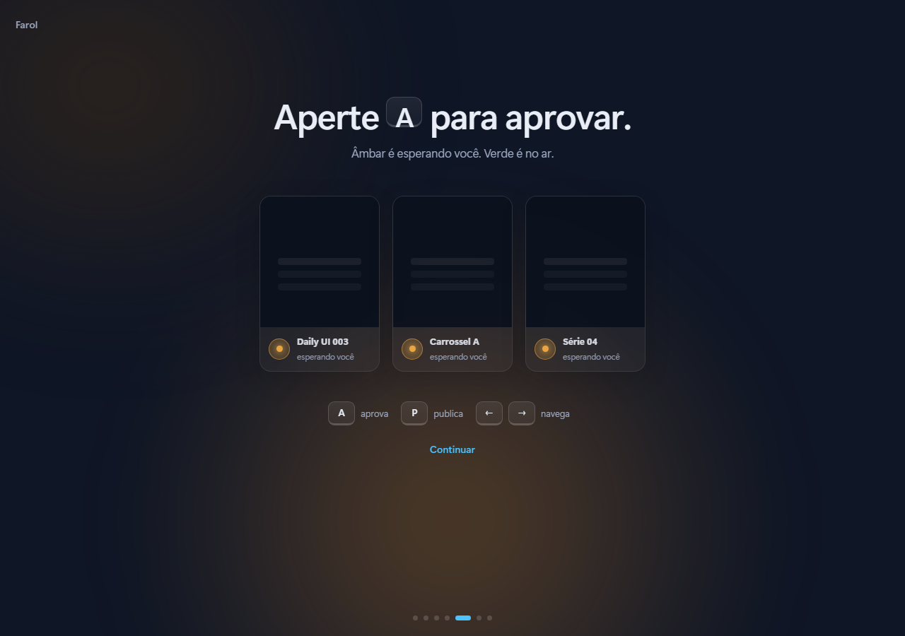
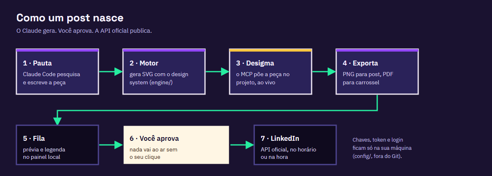
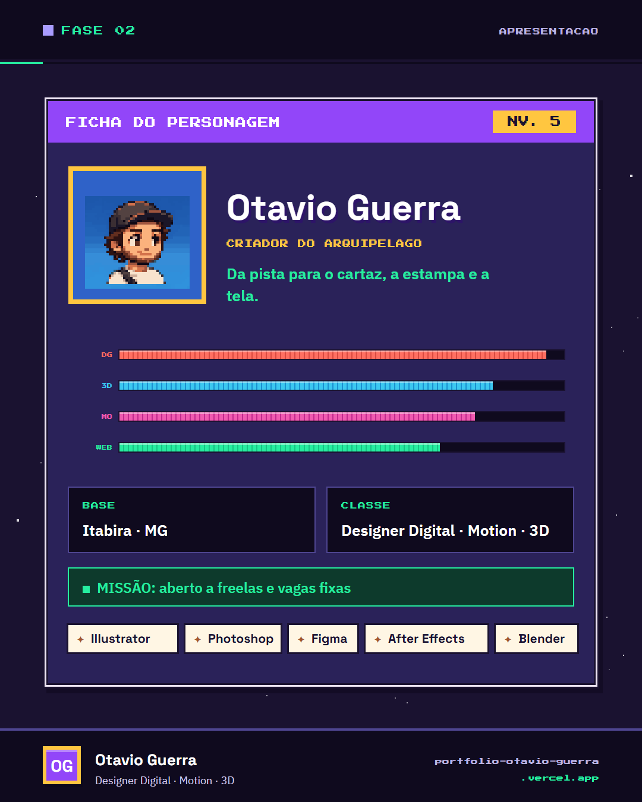
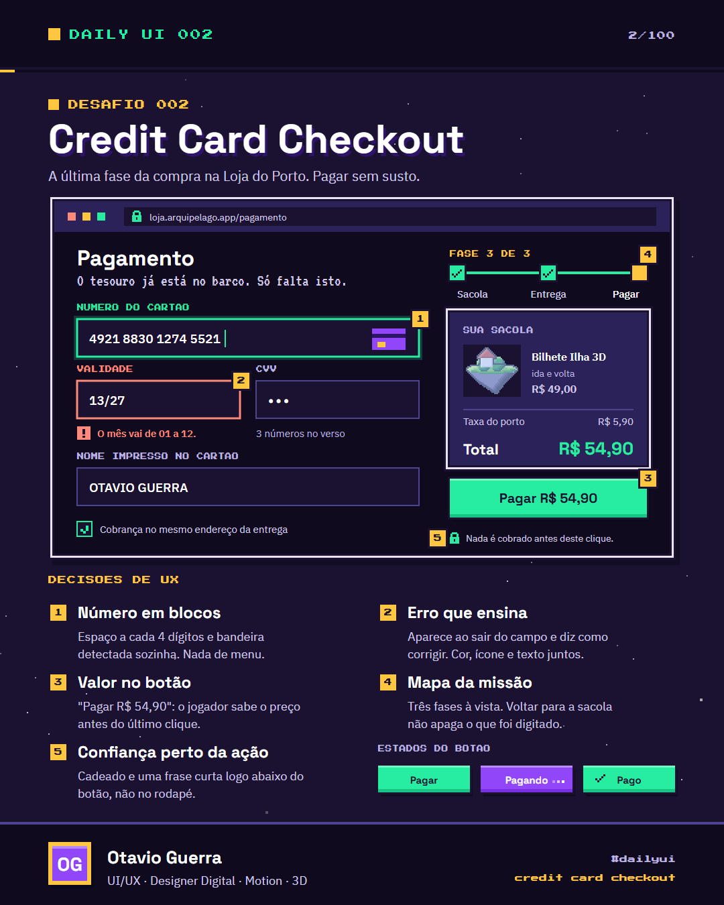
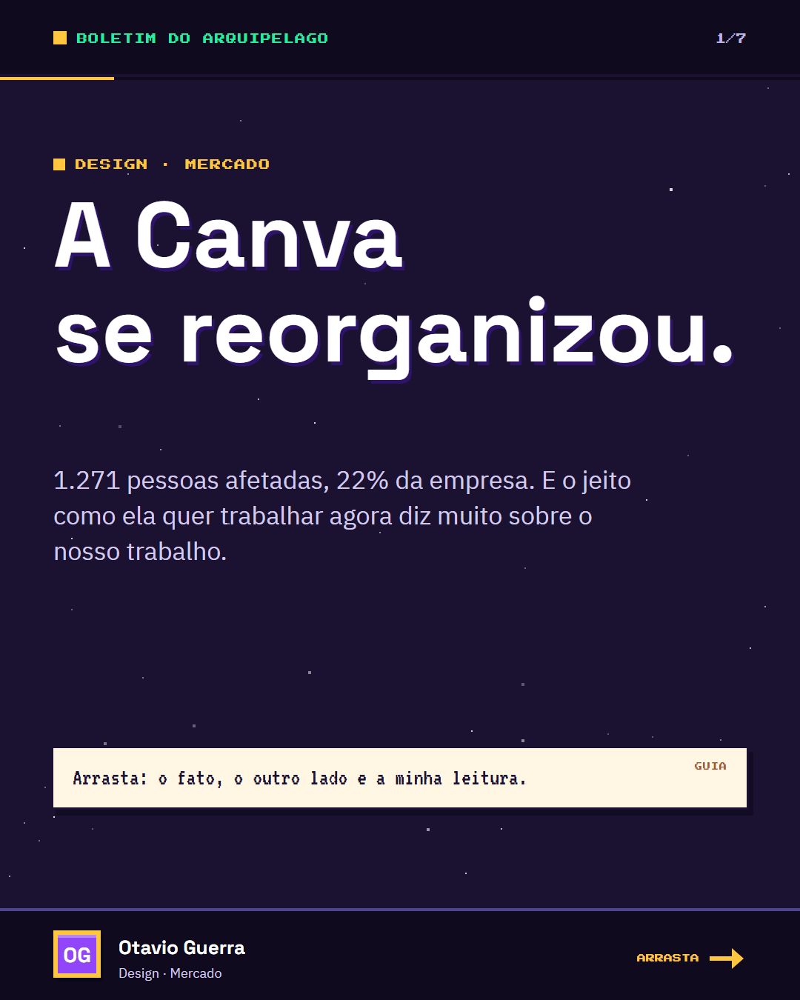
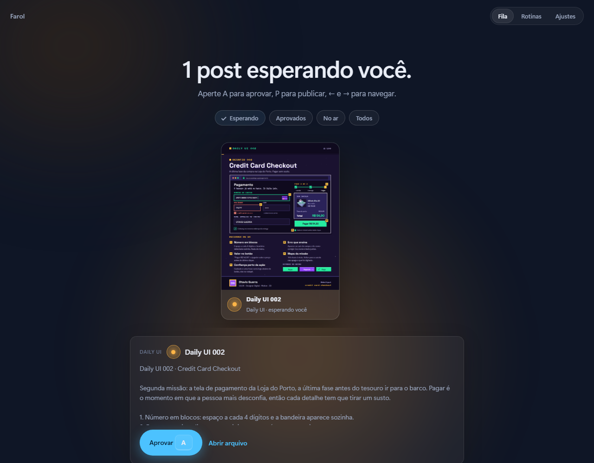

# Farol

**Seus posts no ar, do seu jeito. Nada sai sem você.**

O Farol é um motor de conteúdo para LinkedIn, feito por um designer para designers:
- o **Claude Code** pesquisa e desenha as peças no seu design system;
- o **Desigma** monta tudo num projeto editável;
- o **app local do Farol** cuida da parte que é sua: olhar, aprovar e publicar.

**[Ver a demonstração online](https://farol-otavio-guerra.vercel.app)** · **[Baixar para testar](https://github.com/AbapaOnSwamp/farol/releases/latest)**

| Boas-vindas | Conexões | Aprovar |
|---|---|---|
|  |  |  |



Nasceu para o meu próprio perfil ([portfolio-otavio-guerra.vercel.app](https://portfolio-otavio-guerra.vercel.app)), com três frentes:
- uma série de 30 posts sobre o meu trabalho;
- o desafio [Daily UI](https://www.dailyui.co/), feito dentro do universo do meu portfólio;
- dois carrosséis de notícias por dia sobre IA, tecnologia e design.

| Série própria | Daily UI | Carrossel de notícias |
|---|---|---|
|  |  |  |

## O que ele faz
- **Gera peças com o seu design system.** Tudo é desenhado por código (`engine/brand`): cores, fontes, molduras e pixel art seguem as regras do seu site. Nada de template genérico.
- **Pauta com checagem.** A rotina de notícias procura os assuntos do dia, confere em fonte primária ou em dois veículos sérios e mostra "o outro lado" quando o dado é disputado.
- **Daily UI com decisões de UX.** Cada tela vem com as decisões numeradas (foco visível, estados, microcopy, acessibilidade), não só o visual.
- **Projeto editável no Desigma.** Cada peça vira um quadro na página certa do seu `.desigma`, sem perder o que você editou à mão.
- **Você aprova, ele publica.** A publicação usa a API oficial do LinkedIn. Nenhuma rotina publica sozinha: sem aprovação, nada vai ao ar.

## O app
Uma ideia por tela, como um onboarding de app nativo. São sete passos:
1. boas-vindas;
2. Claude (detecta o Claude Code e abre o login);
3. LinkedIn (guia para criar o app, chaves e OAuth);
4. Desigma (acha a instalação e registra o MCP no Claude Code com um clique);
5. como aprovar;
6. tema, som e aviso na tela;
7. rotinas.

Depois disso, a **Fila** mostra cada peça com prévia e legenda.

- **Teclado:** `A` aprova, `P` publica, `←` e `→` navegam e `Enter` avança no onboarding.
- **Brilho de fundo:** muda com o estado. Fica âmbar quando há post esperando você, verde quando tudo está aprovado e vermelho quando algo dá errado.
- **Sons:** tudo em Ré maior. Cada tela tem um pad suave, aprovar e desfazer são dois toques numa quinta (Ré5 e Lá5) e publicar é um arpejo.
- **Movimento reduzido:** quem pede menos movimento no sistema não vê animação.



## Começar
Precisa de:
- **Node 20+**;
- **[Claude Code](https://docs.claude.com/en/docs/claude-code/setup)**;
- **Microsoft Edge** (para exportar PNG e PDF);
- **[Desigma](https://github.com/deepfounder-ai/desigma/releases)**, se quiser o projeto editável.

As fontes do design system de exemplo (Space Grotesk, IBM Plex Sans, Press Start 2P, VT323 e DM Serif Display, todas do Google Fonts) precisam estar instaladas para as exportações saírem iguais.

**Jeito fácil (Windows):** baixe o `.zip` na [página de releases](https://github.com/AbapaOnSwamp/farol/releases/latest), extraia e dê dois cliques em `Iniciar Farol.cmd`. Ele confere o Node e abre o app no navegador.

**Pelo terminal:**
```bash
git clone https://github.com/AbapaOnSwamp/farol
cd farol
npm start
```
Depois é seguir o onboarding. Para mudar caminhos à mão, copie `config/engine.config.example.json` para `config/engine.config.json`.

## Segurança
- O app escuta só em `127.0.0.1` e toda ação exige um token novo a cada vez que ele sobe. Assim, um site aberto no navegador não consegue agir por você.
- O Client Secret e o token do LinkedIn ficam em `config/`, que está fora do Git. O app nunca devolve o segredo para a tela.
- As rotinas do Claude rodam com as ferramentas limitadas: podem ler e escrever no repositório, rodar `node`, pesquisar e usar o MCP do Desigma. O script de publicação é bloqueado para elas.
- O token do LinkedIn vence em cerca de 60 dias. O app mostra a data, e reconectar leva um clique.

## Estrutura
```
app/            o app local (server.js sem dependências + public/)
engine/
  brand/        tokens e peças do design system (lib.js, kit.js)
  series/       série de posts próprios
  dailyui/      telas do Daily UI (dias/NNN.js) e a lista dos 100 temas
  noticias/     carrosséis: pautas, gerador e exportação em PDF
  desigma/      juntar páginas e anexar quadros no .desigma
  linkedin/     OAuth e publicação pela API oficial
prompts/        instruções das rotinas para o Claude Code
examples/assets imagens de exemplo (pixel art do meu portfólio)
workspace/      tudo o que é gerado (fora do Git)
config/         configuração local e segredos (fora do Git)
```

## Agendar
Para rodar todo dia, crie tarefas agendadas no app do Claude apontando para `prompts/daily-ui.md` e `prompts/pauta-noticias.md`, ou use o Agendador de Tarefas do Windows (a tela Rotinas mostra o comando). A publicação continua passando pela sua aprovação.

## Créditos
- A linguagem da interface (uma ideia por tela, brilho de estado, keycaps, pílula de aviso) foi inspirada no onboarding do **[Mutto](https://mutto.app)**, um app brasileiro para mutar o microfone. O código e os sons do Farol foram feitos do zero.
- Construído por mim com o **[Claude Code](https://claude.com/claude-code)** como par de programação: eu defini o design system, o fluxo e as regras (o que pode e o que não pode ir ao ar sozinho), e o Claude escreveu boa parte do código comigo.

## Licença
Código sob licença MIT. As imagens de `examples/assets` e os textos da série são meus e estão aqui só como exemplo.
